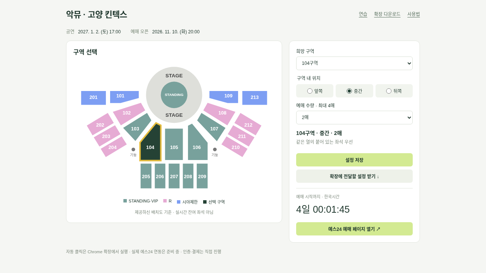

# 악뮤 고양 킨텍스 예매 도우미

**[웹앱 열기](https://fung123-ksjeil.github.io/akmuticketing/)** · **[구매 없는 연습](https://fung123-ksjeil.github.io/akmuticketing/demo.html)**



악뮤 고양 킨텍스 공연 전용입니다. 공연 등록·다른 공연 선택 기능은 없습니다.

- 공연: **2027년 1월 2일(토) 오후 5시 KST**
- 예매 오픈: **2026년 11월 10일(화) 오후 8시 KST**
- 고정 주소: https://ticket.yes24.com/Special/60840

## 사용법

1. 배치도에서 **희망 구역**을 누릅니다. 사용자 제공 배치도를 바탕으로 그린 구역도이며, 실시간 잔여 좌석이나 실제 열 배치를 표시하지 않습니다.
2. **앞쪽·중간·뒤쪽**, **1~4매**를 선택하고 저장합니다. 기본값은 **104구역 / 중간 / 2매**입니다.
3. **확장에 전달할 설정 받기**로 설정 파일을 저장합니다.
4. GitHub의 **Code → Download ZIP**으로 내려받고 압축을 풉니다. Chrome의 `chrome://extensions` → 개발자 모드 → 압축해제된 확장 프로그램 로드 → `extension` 폴더를 선택합니다. 이전 버전 설치 사용자는 확장을 새로고침하세요.
5. 확장에서 **웹에서 선택한 설정 가져오기**로 파일을 가져옵니다. 확장에서도 구역·위치·수량을 직접 변경할 수 있습니다.

선택 구역을 먼저 찾고, 나머지 **104 → 105 → 106 → 103 → 107** 순서로 확장합니다. 같은 열·통로 블록의 연속 좌석을 우선합니다. 선호 위치는 실제 전체 열 수를 앞·중간·뒤 세 부분으로 나누어 적용합니다. 우선 구역에 원하는 연속 좌석이 없으면 **검증된 실제 좌석 배치 좌표**가 있는 경우에만 인접 구역을 찾습니다. 숫자가 비슷하다는 이유로 인접하다고 추측하지 않습니다.

## 중요한 현재 제한

**실제 예스24 연동은 아직 완료되지 않았습니다.** 클라우드 네트워크가 예스24 접근을 차단해 실제 버튼·좌석 DOM·프레임 흐름을 분석하지 못했습니다. 공연 정보는 사용자 제공이며 공식 공지와 대조되지 않았습니다. 사용자 제공 구역도는 반영했지만 개별 열·좌석 데이터는 없습니다.

실제 예매 화면의 버튼 및 좌석 어댑터를 검증하기 전에는 실전 자동 예매에 사용하지 마세요. 로그인·대기열·보안문자·실제 입금은 사용자가 직접 진행합니다. 마지막 결제하기는 사용자가 직접 누릅니다. 설정한 DOM 요소에 대한 클릭 보조이며 티켓 확보를 보장하지 않습니다.

## 예매 준비와 자동 진행

확장에서 실제 버튼을 지정하고 **현재 화면 점검**으로 확인합니다. 예매 10분 전 자동 열기를 예약하면 Chrome과 컴퓨터가 켜 있을 때 공연 탭을 엽니다. 로그인 완료 표시를 설정하면 감지 후 공연으로 돌아가고, 미설정 시 **로그인 완료 · 공연 복귀 후 시작 대기**를 사용합니다. 시작 후 2분 안에 버튼이 활성화되면 한 번 클릭합니다. 페이지 이동·새 창·새로고침 시 자동 진행은 이어지지 않으며 별도 연동이 필요합니다. 알림·시각은 로컬 시계와 브라우저 상태의 영향을 받습니다.

고급 설정의 자동 진행 순서:

- CSS 선택자 한 줄: 정확히 하나의 활성화된 버튼을 한 번 클릭합니다.
- `SEATS`: 선택한 구역·위치·수량의 연속 좌석을 누르고 선택 완료 상태를 확인합니다.
- `WAIT CSS선택자`: 해당 수동 화면이 사라질 때까지 기다립니다.
- 사람 확인·결제 진행 중 화면 CSS: 보이는 동안 자동 클릭을 멈춥니다.

일반 자동 클릭은 최종 결제를 실행하지 않습니다. 무통장 전용 순서도 입금은행·동의까지만 준비하고 마지막 결제하기는 직접 누르게 합니다. 사용자 단계 이후 다음 지정 버튼이 나타나면 이어서 진행할 수 있습니다. 수동 화면 감지는 사이트별 설정이 필요하며 CAPTCHA 해결이나 우회를 수행하지 않습니다.

## 제공된 예스24 예매 순서

연습 화면과 선택 가능한 예스24 전용 순서는 아래 흐름을 따릅니다.

`예매하기 → 달력 2027-01-02 → 17:00 회차 → 좌석선택 → 희망 연속 좌석 → 좌석선택 완료 → 다음단계(좌석 확인) → 다음단계(할인/쿠폰) → 다음단계(수령방법) → 무통장입금 → 국민은행(없으면 첫 유효 은행) → 모두 동의합니다 → 준비 완료 → 사용자가 결제하기 → 예매 완료 확인`

**결제방법은 무통장입금으로 고정합니다.** 선택 가능한 국민은행을 우선하고, 국민은행이 없거나 점검·비활성 상태이면 목록에서 안내 항목을 제외한 첫 유효 은행을 고릅니다. 유효 은행이 없으면 신청하지 않습니다. 전체 동의까지 준비한 뒤 프로그램은 멈춥니다. 금액·내용을 확인하고 **마지막 ‘결제하기’는 사용자가 직접** 눌러야 합니다. 프로그램은 최종 신청이나 재신청을 실행하지 않습니다. 예매내역에서 입금은행·금액·입금기한을 확인하고 **실제 입금은 사용자가 직접** 해야 합니다.

확장의 **예스24 진행 순서 · 고급 설정**에서 해당 순서를 선택할 수 있습니다. 단, 아래의 실제 단계별 CSS 선택자를 검증해 JSON으로 설정해야 합니다. 화면 캡처만으로 실제 선택자를 확인할 수 없어 기본값은 비어 있습니다. 첨부 예시의 부산·다른 공연 번호나 개인정보를 고양 공연 설정에 사용하지 않았습니다.

- 시작: `booking`
- 달력: `calendarStage`, `calendarMonth`, `calendarNext`, `calendarDay`, `selectedDate`
- 회차: `session` (버튼/목록인 경우 선택 완료 상태를 가리키는 `selectedSession` 추가)
- 좌석: `seatEntry`, `seatStage`, `seatDone`
- 좌석 확인: `seatConfirmationStage`, `seatConfirmationNext`
- 할인/쿠폰: `discountStage`, `discountNext`
- 수령방법: `deliveryStage`, `deliveryNext`
- 결제: `paymentStage`, `bankTransfer`, `bankSelect`, `agreeAll`, `submitBooking` (버튼 확인만 하며 자동 클릭하지 않음)

단계 화면(stage)은 해당 단계에서만 보이는 요소를 가리켜야 합니다. 다음단계 버튼은 직전 화면이 사라지고 다음 화면이 나타났는지 확인할 때까지 반복 클릭하지 않습니다. 전환을 15초 안에 확인하지 못하면 중단합니다. 1월 2일 선택 전 달력 연월을 확인하고, 17시 회차 선택 상태가 확인되지 않으면 진행하지 않습니다. 미입력 배송정보 등으로 버튼이 비활성화되면 사용자가 확인해야 합니다.

**실제 사이트의 별도 예매 팝업·iframe·다른 문서로 이동하는 흐름은 아직 지원하지 않습니다.** 현재 검증은 같은 문서에서 단계를 전환하는 연습 화면에 대한 것입니다. 실제 예스24 자동 예매가 완성됐다는 의미가 아닙니다.

## 좌석 어댑터

아래 정보가 실제 좌석 DOM에 있거나 검증된 어댑터로 제공되어야 합니다. 속성 이름은 확장에서 바꿀 수 있습니다.

| 정보 | 기본 속성 |
|---|---|
| 구역 / 열 / 번호 | `data-section`, `data-row`, `data-number` |
| 통로 블록 | `data-block` |
| 판매 가능 / 선택 완료 | `data-available="true"`, `data-selected="true"` |
| 무대 앞에서부터 열 순서 / 전체 열 수 | `data-row-index`, `data-row-total` |
| 실제 배치 X/Y 좌표 | `data-seat-x`, `data-seat-y` |

열 정보가 없으면 앞·중간·뒤를 추정하지 않고 중단합니다. iframe·canvas 좌석, 새 창 예매는 추가 개발이 필요합니다. 현재 클라우드 Chromium은 관리자 정책으로 확장 로드를 금지하므로 실제 확장의 브라우저 통합 검증은 개인 Chrome에서 해야 합니다.

## 개발·검증

Node.js 22 이상. 외부 실행 의존성은 없습니다.

```sh
npm start
npm test
```

브라우저 테스트(선택):

```sh
npm install --no-save --package-lock=false playwright
npx playwright install chromium
# npm start를 실행한 상태에서
npm run test:web
```

웹 테스트는 구역도·위치·최대 4매·설정 유지·내보내기와 구매 없는 자동 흐름을 확인합니다. `npm test`는 좌석·위치·인접 구역·예약·로그인 복귀 로직을 검사합니다. 실제 좌석 확보나 결제 테스트는 실행하지 않습니다. 웹 게시는 `gh-pages` 브랜치의 정적 파일을 사용합니다.
